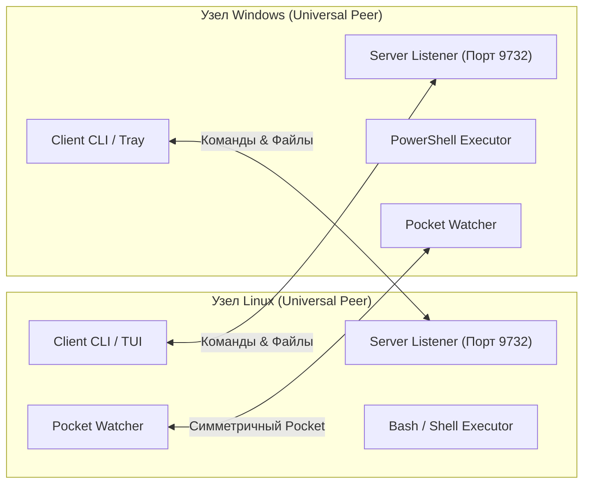

# Bridge Local: План обновления v0.3.0 (PLAN UPDATE 0.3.0)

> **Статус**: Стратегический план архитектуры v0.3.0  
> **Концепция**: Универсальный симметричный узел (Universal P2P Node) и Win-Win взаимодействие.  
> **Главный принцип**: Каждая машина является одновременно и сервером (агентом), и клиентом (хостом).

---

## 1. Концепция симметричной P2P архитектуры (Win-Win Connect)

### Проблема текущей архитектуры v0.1/v0.2
В версиях 0.1 и 0.2 была жесткая асимметрия:
- **Linux** выступал исключительно как *Клиент/Контроллер* (только отдает команды и забирает файлы).
- **Windows** выступал исключительно как *Агент/Сервер* (только принимает команды и отдает файлы).

В реальной жизни оператор может пересесть за игровой/рабочий ПК с Windows, и ему нужно отправить команду или файл обратно на Linux.

### Архитектура v0.3.0: Dual-Role узел
В версии 0.3.0 любое устройство поднимает **единый универсальный рантайм**:



---

## 2. Сценарии Win-Win взаимодействия

### 2.1 Управление Linux из Windows (Windows ➔ Linux)
Оператор за Windows может управлять рабочей станцией Linux точно так же, как раньше управлял Windows:
- **Удаленное выполнение Bash-команд**:
  ```cmd
  bridge-agent exec "systemctl status docker"
  bridge-agent exec "git pull && cargo build" -d "/home/user/Projects"
  ```
- **Запуск тяжелых фоновых скриптов на Linux**:
  ```cmd
  bridge-agent exec "nohup python3 training.py > train.log 2>&1 &"
  ```
- **Скачивание и отправка файлов из Windows в Linux-карман**.
- **Просмотр файловой системы Linux**: `bridge-agent ls "/home/user/Downloads"`.

### 2.2 Управление Windows из Linux (Linux ➔ Windows)
Классический сценарий сохраняется в полном объеме:
- Вызов PowerShell с правами администратора: `bridge-cli exec "Get-Process"`.
- Запуск оконных приложений без зависания: `Start-Process`.
- Быстрый переброс файлов и мониторинг нагрузки Windows.

### 2.3 Симметричные связки (Linux ➔ Linux и Windows ➔ Windows)
- Мост между двумя Linux-машинами (ноутбук + домашний сервер).
- Мост между двумя Windows-машинами (ПК + планшет/ноутбук).
- Единый протокол и код без переписывания архитектуры.

---

## 3. Архитектурные компоненты универсального узла

### 3.1 Симметричный исполнитель команд (`RemoteExecutor`)
На каждом узле регистрируется нативный для платформы исполнитель:
* **На Windows**: `PowerShellExecutor` (UTF-8, сохранение CWD, `chcp 65001`, права Администратора).
* **На Linux**: `BashExecutor` (UTF-8, сохранение CWD, запуск от имени непривилегированного пользователя или через `sudo`, неблокирующий I/O).

### 3.2 Единый диспетчер RPC и Сервер
* Каждый узел при старте фоновой службы (`systemd` на Linux или `SCM` на Windows) открывает порт `9732` и регистрирует общий набор методов:
  - `ping` — метрики и статус узла.
  - `exec.run` — удаленное выполнение нативного шелла.
  - `fs.list` / `fs.stat` — удаленный просмотр каталогов (`ls`).
  - `pocket.push` / `pocket.pull` / `pocket.manifest` — файловый обмен.
  - `notes.send` / `notes.history` — обмен сообщениями.
---

## 4. Пользовательский интерфейс и утилиты управления

* **На Linux**:
  - `bridge-cli` сохраняет свой удобный CLI/TUI интерфейс, но в фоне работает юнит `bridge-agent.service` (готов принимать входящие вызовы с Windows).
* **На Windows**:
  - `bridge-agent` сохраняет трей и контекстное меню, но получает полноценную консольную команду `bridge-agent.exe exec <cmd>`, позволяющую оператору выполнять команды на Linux прямо из Windows PowerShell или CMD.
  - Интеграция контекстного меню: пункт «Выполнить на Linux» для `.sh` скриптов.

---

## 5. Дорожная карта перехода (0.2.0 ➔ 0.3.0)

1. **Фаза 0.2.0**:
   - Автодискавери (UDP beacon).
   - Независимый трей и фоновый демон Windows.
   - Event-driven автосинхронизация кармана (inotify / ReadDirectoryChangesW).
   - Компактный UI (Fullscreen Adaptive + Micro HUD).
   - Защита от MiTM (AEAD XChaCha20-Poly1305).
   - Команды `ls`, `find`, `pocket -B`, `token`, `pocket clear`.
2. **Фаза 0.3.0**:
   - Объединение клиентского и серверного рантайма в симметричный `bridge-node`.
   - Реализация `BashExecutor` для Linux-сервера.
   - Добавление клиентских команд `exec` и `ls` в Windows-бинарник.
   - Полноценный симметричный Win-Win коннект.

